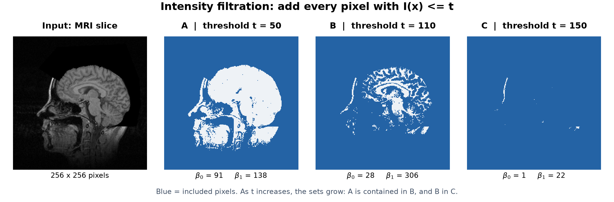
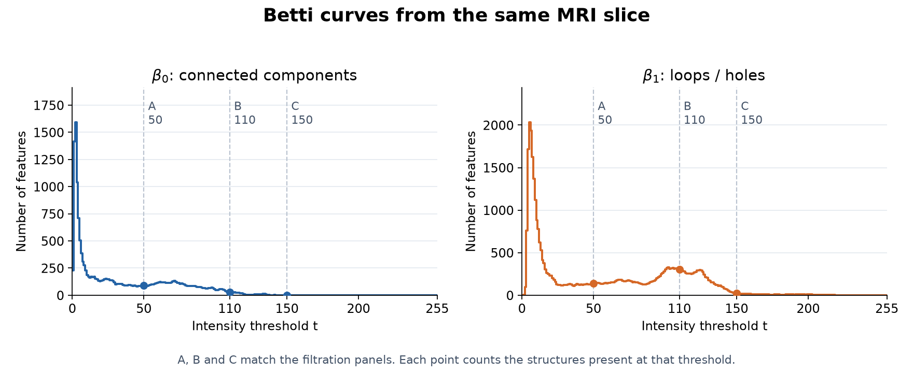

# TopoImage: Persistent Homology for Image Classification

Extract topological features from images and use them as inputs to a classifier.

**Image → intensity filtration → Betti curves → feature vector → binary classifier**

- **`topo.py`**: extract topological representations from 3D images, including Betti curves and persistence landscapes, and save features as `.npy` files.
- **`topo_classify.py`**: load topology features and train an SVM; the script also contains a PCA option.
- **`examples/visualize_betti.py`**: a small, self-contained 2D MRI example that generates the two figures below.

## 1. What is the filtration process?

Start with a grayscale image `I`, normalized to 0–255. At threshold `t`, include every pixel with **`I(x) <= t`**, together with its edges and vertices. Increasing `t` gives nested sets: dark pixels enter first, then brighter pixels. Components can appear and merge; holes can form and fill in.



**Figure 1.** The left panel is the input MRI slice. In A–C, blue pixels belong to the current cubical complex and pale pixels have not entered yet. The counts below each panel are computed from that exact set, using GUDHI. These are thresholded pixel sets, rather than illustrative connections drawn between sampled points.

## 2. What do the Betti curves measure?

- **β₀(t)** counts connected components at threshold `t`.
- **β₁(t)** counts loops / holes at threshold `t`.
- **β₂(t)** counts enclosed cavities in 3D. It is not shown for this 2D slice.



**Figure 2.** The horizontal axis is the intensity threshold; the vertical axis is the number of structures present. A, B and C correspond exactly to Figure 1. The two curves describe different topological dimensions of **one image**, not two diagnostic classes. For example, at `t = 110`, this image has 28 connected components and 306 holes.

The demo uses cubical persistent homology over Z/2Z and counts intervals satisfying `birth <= t < death`. It keeps all positive-lifetime features and the essential connected component, with no denoising or lifetime cutoff. Small structures can therefore contribute to the curves. Unlike this demo, the original `topo.py` removes infinite intervals before vectorization.

## 3. Using Betti curves for binary classification

Sample every image's curves on the **same threshold grid**, then concatenate the values:

```text
one image → [β₀(0), …, β₀(255), β₁(0), …, β₁(255)] → 512 features
N labeled images → feature matrix X (N × 512), labels y (0 or 1)
X → scaling → optional PCA → SVM → predicted class
```

The included [`mri_betti_curves.npy`](img/mri_betti_curves.npy) has shape `(2, 256)`: row 0 is β₀, row 1 is β₁. Load and flatten it with:

```python
import numpy as np

curves = np.load("img/mri_betti_curves.npy")
feature = curves.reshape(-1)  # 512 numbers for this image
```

For a labeled dataset, these vectors can be used for binary tasks such as positive vs. negative, or benign vs. malignant, according to the dataset's labels. Split by patient before fitting the scaler, PCA or classifier; evaluate on held-out patients. This single, unlabeled MRI is an extraction example, not a binary-classification experiment or evidence of diagnostic accuracy.

## Reproduce the figures

```bash
pip install numpy pillow matplotlib gudhi
python examples/visualize_betti.py
```

This regenerates both figures and the `.npy` feature file from the included [`mri_slice.png`](img/mri_slice.png), without downloading any patient data. The original `topo.py` and `topo_classify.py` are research scripts with dataset-specific paths; `topo.py` also requires a local `trans.py` ROI helper that is not included in this repository.

**Image source.** University of North Carolina, *Chapel Hill Volume Rendering Test Data Set, Volume II*, MRbrain slice 60, available from the [Stanford volume data archive](https://graphics.stanford.edu/data/voldata/). The data are public domain. The supplied PNG is a 256 × 256 slice linearly normalized from its original 16-bit intensities to 8-bit (rounded, without smoothing or cropping). See [source information](img/mri_source.txt) for acknowledgements and the accompanying archive announcement.

**Related example.** The breast MRI visualization in [Du et al., MICCAI 2022](https://doi.org/10.1007/978-3-031-16434-7_6) motivated this explanation. The figures here are newly computed from a separate brain MRI; they do not reproduce that paper's breast dataset or results.

## Future work — written on 2026-11-06

- **Go beyond Betti curves.** They may be too simple to capture useful differences. Combine and compare richer features, such as persistence landscapes, persistence images and persistence entropy, rather than relying on Betti curves alone.
- **Visualize differences between two classes.** Compare feature distributions and curves for labeled groups (e.g., positive vs. negative, or benign vs. malignant). Start with one-dimensional structures (H₁ loops / holes) and inspect which structures persist across thresholds. These comparisons remain future work; no class difference is claimed in the single-image example above.
